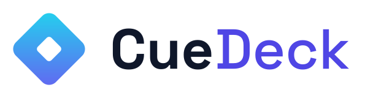
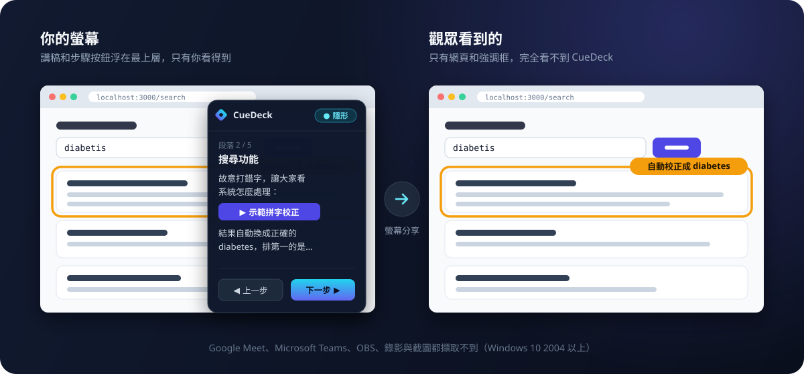
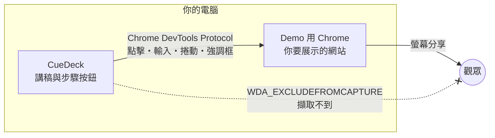

<div align="center">

<picture>
  <source media="(prefers-color-scheme: dark)" srcset="assets/logo-dark.svg">
  
</picture>

### 現場 Demo 的隱形劇本

講稿只有你看得到，點一下就幫你操作網頁。<br>
螢幕分享時，觀眾只會看到你要他們看的畫面。

[](https://github.com/yi-luan/cuedeck/releases/latest)
[](#平台支援)
[](https://www.electronjs.org/)
[](LICENSE)

[⬇ 下載](https://github.com/yi-luan/cuedeck/releases/latest) · [快速開始](#快速開始) · [使用指南](#使用指南) · [劇本格式](#劇本格式) · [常見問題](#常見問題)

</div>

<br>

<p align="center">
  
</p>
<p align="center"><sub>示意圖：同一個時間點，你的螢幕與觀眾看到的畫面</sub></p>

---

## 為什麼需要 CueDeck

做 PowerPoint 簡報時，有簡報者檢視畫面可以看備忘稿。可是**現場操作真實系統**的 Demo 沒有這種東西，常見的狀況是：

- **忘詞、漏講**：一邊操作一邊講，講稿只能記在腦袋裡，或是印出來放在旁邊。
- **操作卡住**：當場找按鈕、打字打錯、捲半天找不到要給大家看的區塊。
- **講稿露餡**：只有一個螢幕時，把講稿開在旁邊，分享整個螢幕就會一起被看到。
- **重點不明顯**：觀眾不知道該看畫面上的哪裡。

CueDeck 把**講稿**和**網頁操作**寫進同一份劇本。講到哪裡點一下，CueDeck 就在 Demo 用的 Chrome 裡幫你點擊、輸入、捲動，再用強調框把重點框給觀眾看。CueDeck 視窗本身不會被螢幕擷取拍到，所以只有一個螢幕也能放心分享。

## 功能特色

| | 功能 | 說明 |
| :---: | --- | --- |
| 👻 | **螢幕分享看不到** | Google Meet、Teams、OBS 分享整個螢幕或錄影時，都拍不到 CueDeck 視窗 |
| ▶️ | **一鍵操作網頁** | 每個步驟是一顆按鈕，可以點擊、輸入、按鍵、捲動、等待、換頁，或執行自訂 JavaScript |
| 🟧 | **強調框** | 把觀眾該看的區塊框起來，還能加一行說明文字 |
| 🎯 | **點選建立步驟** | 在網頁上直接點元素，自動產生穩定的 CSS selector，不用打開 DevTools |
| 📝 | **講稿內嵌觸發點** | 在講稿寫 `{{步驟名稱}}`，講到那句話就點那裡；「下一步」也照講稿的順序推進 |
| ⌨️ | **全域快速鍵** | 不必切換視窗，在任何程式裡都能推進、倒退、重跑目前的步驟 |
| 📺 | **投影機模式** | 接上 HDMI 時自動提示，把 CueDeck 留在筆電、Chrome 移到投影幕 |
| 🧪 | **彩排檢查** | 用無頭 Chrome 把整份劇本跑一遍，Demo 前就知道哪個步驟壞了 |
| 📄 | **開放格式** | 劇本是附 JSON Schema 的 JSON 檔，可以版本控管、分享，也能由其他系統產生 |

## 適合誰

**適合**需要在真實系統上現場操作的場合：

- 售前工程師、業務的產品 Demo
- Sprint review、功能驗收、內部分享會
- 課堂或研討會上的系統 Demo
- 教育訓練時一步一步帶操作

**不適合**只放投影片的報告。如果整場都是 PowerPoint，用 PowerPoint 內建的**簡報者檢視畫面**就夠了，翻頁和備忘稿還會自動同步。CueDeck 目前只能操作 Chrome 裡的網頁，不能控制 PowerPoint。

## 快速開始

### 環境需求

- Windows 10 2004 以上（隱形功能需要這個版本以上的系統 API）
- Google Chrome 或 Microsoft Edge
- 從原始碼執行時另需 [Node.js](https://nodejs.org/) 18 以上

### 安裝

**方法一：安裝檔**

到 [Releases](https://github.com/yi-luan/cuedeck/releases/latest) 下載 `CueDeck-Setup-<版本>.exe` 並執行。安裝後：

- 開始功能表和桌面都會有 **CueDeck** 捷徑。
- 第一次啟動時，範例劇本和 schema 會複製到 `文件\CueDeck\`，新增的劇本預設也存在這裡。
- 重複啟動不會開出第二個視窗，而是叫出已經開著的那一個。
- 安裝檔沒有程式碼簽章，第一次執行時 Windows SmartScreen 可能會顯示「Windows 已保護您的電腦」，按「其他資訊 → 仍要執行」即可。

**方法二：從原始碼執行**

```bash
git clone https://github.com/yi-luan/cuedeck.git
cd cuedeck
npm install
node node_modules/electron/install.js   # 下載 Electron 本體
npm start
```

> npm 11 預設會擋套件的安裝腳本（會出現 `allow-scripts` 警告），所以 `npm install` 不會自動下載 Electron 執行檔，要另外跑第三行。
> 從 GitHub 下載太慢的話可以改用鏡像站：
> `ELECTRON_MIRROR=https://npmmirror.com/mirrors/electron/ node node_modules/electron/install.js`

### 五分鐘跑第一次 Demo

1. **開 Demo 用的 Chrome**：按 CueDeck 工具列的地球圖示。標題列出現綠色的「Chrome」就是連上了。
2. **建立劇本**：選單「⋯」→「新增空白劇本」，填上 Demo 網址（例如 `http://localhost:3000`）。
3. **加一個步驟**：按「從頁面選取」，到 Chrome 裡點一個按鈕，選「點擊並強調」。
4. **寫講稿**：在段落講稿裡寫一句話，用「插入觸發點…」把剛剛的步驟插進去。
5. **試講**：切到簡報模式，按 `Ctrl+Alt+→`，看 Chrome 自動點下去並框出重點。

確認沒問題之後，在 Meet 或 Teams 選「分享整個螢幕」，先用分享預覽確認看不到 CueDeck，就可以開始了。

## 使用指南

### 1. 準備 Demo 環境

1. 把要 Demo 的網站跑起來。
2. 開啟 CueDeck。
3. 按工具列的**地球圖示**啟動「Demo 用 Chrome」。這是一個獨立的 Chrome profile，帶遠端除錯埠 9222。**請在這個視窗裡 Demo**，CueDeck 只能操作它。

### 2. 建立劇本（編輯模式）

- 選單「⋯」→「新增空白劇本」會建立一份 `.cuedeck.jsonc`。檔案開頭附有完整的讀寫說明和註解掉的範例，用 VS Code 打開就能照著寫。也可以匯入現成的 `.cuedeck.json(c)` 或 Markdown 講稿。
- 填上 **Demo 網址**。
- 每個**段落**有標題和講稿。講稿支援 Markdown，只有你看得到。
- **講稿中的觸發點**：在講稿裡寫 `{{步驟名稱}}`，簡報時那個位置會變成一顆可以點的小按鈕。「下一步」照講稿中出現的順序推進；沒寫進講稿的步驟會列在段落最下面。
  - 「**插入觸發點…**」：把現有的步驟插到講稿游標處（步驟旁的連結圖示也可以）。
  - 「**選取並插在游標處**」：先把游標放在講稿要觸發的位置，再到頁面上選元素。新步驟建好後，觸發點會插在那裡。
  - 步驟改名時，講稿裡的觸發點會跟著改；刪除步驟時，觸發點也會一起移除。
- 按「**從頁面選取**」，到 Demo Chrome 點一下元素（滑鼠移過去會出現藍框，按 Esc 取消），再選要做什麼：

  | 選項 | 產生的動作 |
  | --- | --- |
  | 點擊 | 捲到看得到的位置後點擊（切頁籤、按按鈕） |
  | 捲動到這裡 | 把這個區塊平滑捲到畫面中央 |
  | 強調框 | 捲過去並框起來，可以加一行給觀眾看的說明 |
  | 點擊並強調 | 點擊後再框起來 |
  | 輸入文字 | 逐字打進輸入框（選到輸入框時才會出現） |

  元素上有文字時，也可以改用「畫面文字」來定位。網頁改版、selector 變了，步驟通常還是能用。
- 每個步驟旁的準心圖示可以再選一個元素**追加**到同一個步驟，例如先點分頁、再框出結果。
- **指令列**：每個步驟下方可以直接打字，例如 `click #search-btn; wait 800; highlight #result "就是這裡"`。
- **共用流程**：常用的一串動作可以寫成共用流程，在步驟裡用 `flow 名稱` 呼叫。
- `Ctrl+S` 存檔。直接用 VS Code 改 JSON 也可以，存檔後 CueDeck 會自動重新載入。

### 3. 正式 Demo（簡報模式）

在 Meet 或 Teams 選「分享整個螢幕」，或「分享視窗 → Demo 用 Chrome」，然後照著講稿講，點步驟按鈕或用快速鍵推進：

| 快速鍵（任何視窗都有效） | 作用 |
| --- | --- |
| `Ctrl+Alt+→` | 執行下一步 |
| `Ctrl+Alt+←` | 回到上一步並執行 |
| `Ctrl+Alt+↓` | 重跑目前這一步 |
| `Ctrl+Alt+H` | 隱藏或顯示 CueDeck |

> [!TIP]
> 第一次使用時，先用 Meet 的分享預覽確認 CueDeck 真的沒被拍到。標題列顯示「隱形」代表保護開著；顯示黃色的「可見」代表保護被關掉了，可以在「⋯ → 外觀與快速鍵」切換。

### 4. 接投影機或外接螢幕

> [!IMPORTANT]
> 「隱形」只擋得住**螢幕擷取**（Meet、Teams、OBS、錄影、截圖），**擋不住 HDMI**。HDMI 輸出的是顯示卡直接送出的畫面，作業系統沒辦法只在其中一邊隱藏視窗。

所以接投影機時要靠螢幕配置：

1. 按 `Win+P` 選「**延伸**」。不要選「同步顯示」，同步顯示時兩邊是同一個畫面，觀眾一定看得到 CueDeck。
2. 接上投影機時 CueDeck 會自動提示。如果 CueDeck 跑到投影幕上，會先把它搬回筆電螢幕。
3. 按提示裡的「**Chrome 移到投影幕**」，Demo Chrome 會移到投影幕並最大化。如果還沒開 Demo Chrome，按地球圖示時就會直接開在投影幕上。
4. 隨時可以從選單「⋯ → HDMI / 投影設定」叫出這個提示。

### 5. 彩排

```bash
npm run rehearse -- decks/my-demo.cuedeck.json
```

用無頭 Chrome 把每個步驟跑一遍，確認所有 selector 都找得到。網站改版後、正式 Demo 前都建議跑一次。

## 劇本格式

劇本的完整定義在 [`schema/cuedeck.schema.json`](schema/cuedeck.schema.json)，範例是 [`decks/project02-demo.cuedeck.json`](decks/project02-demo.cuedeck.json)。檔案開頭加上 `"$schema"`，VS Code 就會提供自動完成和錯誤檢查。

| 副檔名 | 特性 |
| --- | --- |
| `.cuedeck.jsonc` | 允許 `//` 和 `/* */` 註解，新增劇本預設用這個格式。從 CueDeck 存檔時，JSON 本體**前後**的註解會保留，寫在 `{ }` **裡面**的註解會被移除 |
| `.cuedeck.json` | 純 JSON，方便其他系統讀寫。從 CueDeck 存檔時一律寫成純 JSON |

```json
{
  "$schema": "../schema/cuedeck.schema.json",
  "cuedeck": 1,
  "title": "我的 Demo",
  "target": "http://localhost:3000",
  "sections": [
    {
      "title": "搜尋功能",
      "notes": "故意打錯字，展示**拼字校正** {{示範拼字校正}}。",
      "cues": [
        {
          "label": "示範拼字校正",
          "actions": [
            { "do": "click", "text": "檢索" },
            { "do": "type", "selector": "#search-input", "text": "diabetis" },
            { "do": "click", "selector": "#search-btn" },
            { "do": "wait", "ms": 800 },
            { "do": "highlight", "selector": "#results", "caption": "自動校正成 diabetes" }
          ]
        }
      ]
    }
  ],
  "flows": {
    "回首頁": [{ "do": "goto", "url": "/" }, { "do": "scrollTo", "y": "top" }]
  }
}
```

### 動作一覽

| `do` | 欄位 | 指令列寫法 | 說明 |
| --- | --- | --- | --- |
| `goto` | `url` | `goto /path` | 開網址，相對路徑以 `target` 為基準 |
| `click` | `selector` 或 `text`（可加 `within`） | `click #btn` / `clicktext "文字"` | 捲到看得到的位置再點擊 |
| `type` | `selector`, `text` | `type #q "文字"` | 清空後逐字輸入 |
| `press` | `key` | `press Enter` | 按一個鍵 |
| `scroll` | `selector` 或 `text`，`align`：top / center / bottom | `scroll #sec top` | 平滑捲到元素 |
| `scrollTo` | `y`（數字、`top` 或 `bottom`） | `scrollto top` | 捲到頁面的某個高度 |
| `wait` | `ms` 或 `selector` | `wait 500` / `wait .result` | 等一段時間，或等元素出現（最多 15 秒） |
| `waitText` | `text` | `waittext "完成"` | 等頁面出現這段文字 |
| `highlight` | `selector` 或 `text`，`caption`、`ms`（選填） | `highlight #x "說明" 3000` | 強調框（**觀眾看得到**） |
| `eval` | `code` | `eval "..."` | 在頁面裡執行 JavaScript |
| `back` / `reload` | — | `back` / `reload` | 上一頁、重新整理 |
| `flow` | `name` | `flow 名稱` | 執行共用流程 |

### 從其他格式匯入

- **Markdown 講稿**（`.md`）：`## 標題` 會變成段落，`[[按鈕文字|指令列]]` 會變成步驟，```` ```flow 名稱 ```` 區塊會變成共用流程。範例在 [`examples/legacy-markdown.md`](examples/legacy-markdown.md)。匯入後存檔會另存成 `.cuedeck.json`。
- **其他系統**：只要輸出符合 schema 的 JSON 就能匯入，例如測試團隊既有的 E2E 步驟，或各產品各自維護的 Demo 劇本。

## 運作原理



- **隱形**：Electron 的 `setContentProtection(true)` 在 Windows 上會呼叫 `SetWindowDisplayAffinity(WDA_EXCLUDEFROMCAPTURE)`，讓這個視窗不會出現在任何螢幕擷取的畫面裡，但你自己的螢幕照常顯示。
- **操作網頁**：透過 [Puppeteer](https://pptr.dev/) 連到 Demo Chrome 的遠端除錯埠，以 Chrome DevTools Protocol 執行動作。
- **穩定的 selector**：選取器會避開看起來是自動產生的 id 和 class（含長串數字或 hash，例如 CSS-in-JS 產生的名稱），優先使用 `id`、`data-testid`、`data-*`、`name`、`aria-label`。網站有 `data-testid` 時最穩定。

## 平台支援

| 平台 | 狀態 | 說明 |
| --- | --- | --- |
| Windows 10 2004 以上 | ✅ 正式支援 | 提供安裝檔，隱形功能已實測 |
| Windows 10 2004 以前 | ⚠️ 部分支援 | 可以使用，但 CueDeck 在螢幕分享中會變成一塊黑色，而不是完全消失 |
| macOS | 🧪 未實測 | 可從原始碼執行，Electron 在 macOS 上也支援 content protection，但尚未驗證，也沒有提供安裝檔 |
| Linux | ❌ 不支援隱形 | Electron 在 Linux 上不支援 content protection |

## 常見問題

<details>
<summary><b>分享時觀眾還是看得到 CueDeck？</b></summary>

依序檢查：

1. 標題列是否顯示「隱形」。如果是黃色的「可見」，到「⋯ → 外觀與快速鍵」打開保護。
2. 是否接了投影機或外接螢幕，而且選了「同步顯示」。HDMI 輸出擋不住，請改成「延伸」，見[接投影機或外接螢幕](#4-接投影機或外接螢幕)。
3. Windows 版本是否在 10 2004 以上。

</details>

<details>
<summary><b>CueDeck 能控制 PowerPoint 嗎？</b></summary>

目前不行。CueDeck 只能操作 Demo 用 Chrome 裡的網頁。報告中需要在投影片和網頁 Demo 之間切換時，可以用 CueDeck 看講稿、操作網頁，投影片則用簡報筆或鍵盤翻頁。點過 CueDeck 視窗之後，方向鍵會送到 CueDeck，要再點一下投影片放映畫面才能繼續翻頁；改用全域快速鍵就不會搶走焦點。

</details>

<details>
<summary><b>Demo 用 Chrome 沒有我的書籤和登入狀態？</b></summary>

Chrome 136 以後，遠端除錯只能搭配非預設的 profile，所以 Demo 用 Chrome 是一個獨立的 profile。網站需要登入的話，先在裡面登入一次，之後就會記住。

</details>

<details>
<summary><b>開了好幾個分頁，CueDeck 會操作哪一個？</b></summary>

優先操作網址符合劇本 `target`、而且目前在前景的分頁。執行步驟時 Chrome 會切到正確的分頁，但如果 Chrome 視窗被其他視窗蓋住，不會自動跳到最前面。

</details>

<details>
<summary><b>找不到 Chrome？設定檔在哪裡？</b></summary>

設定（視窗位置、透明度、上次開的劇本）存在 `%APPDATA%\cuedeck\settings.json`。CueDeck 找不到 Chrome 時，可以在這裡加上 `"chromePath": "C:\\路徑\\chrome.exe"`。也支援 Microsoft Edge。

</details>

<details>
<summary><b>只分享 Chrome 分頁也可以嗎？</b></summary>

可以。Meet 只分享「Chrome 分頁」時，本來就只拍得到那個分頁，CueDeck 自然不會出現。

</details>

## 開發

```bash
npm start          # 啟動 CueDeck
npm test           # 資料模型、動作引擎、DOM 選取器的自動測試
npm run rehearse -- <劇本>   # 用無頭 Chrome 彩排劇本
```

### 專案結構

```text
cuedeck/
├── src/
│   ├── main.js        Electron 主程序：視窗、隱形、快速鍵、雙螢幕、Chrome 連線
│   ├── actions.js     動作引擎：把劇本裡的動作轉成 Chrome 上的操作
│   ├── model.js       劇本資料模型：讀寫、驗證、觸發點、匯入
│   ├── picker.js      在網頁上點選元素並產生 selector
│   ├── template.js    新劇本的範本
│   ├── preload.js     主程序與畫面之間的橋接
│   └── renderer/      CueDeck 面板的畫面
├── schema/            劇本的 JSON Schema
├── decks/             範例劇本
├── examples/          Markdown 講稿匯入範例
├── test/              自動測試與彩排腳本
├── build/             App 圖示與 logo 產生腳本
└── assets/            logo 與 README 圖片
```

### 打包成安裝檔

```bash
npm run dist
```

產出 `dist/CueDeck-Setup-<版本>.exe`（約 95 MB）。打包時需要下載 Electron 和 NSIS，太慢的話可以加上鏡像站（`package.json` 已經設定好 Electron 的鏡像）：

```bash
ELECTRON_BUILDER_BINARIES_MIRROR=https://npmmirror.com/mirrors/electron-builder-binaries/ npm run dist
```

### 品牌素材

| 檔案 | 用途 |
| --- | --- |
| [`assets/logo-light.svg`](assets/logo-light.svg) | 橫式標準字，用在淺色背景 |
| [`assets/logo-dark.svg`](assets/logo-dark.svg) | 橫式標準字，用在深色背景 |
| [`assets/logo-mark.svg`](assets/logo-mark.svg) | 單獨的菱形標誌，透明背景 |
| [`assets/app-icon.svg`](assets/app-icon.svg) | App 圖示（深色圓角底板） |

標誌是一個中間挖空的菱形，代表講稿裡的「提示點（cue）」；漸層由青色 `#22d3ee` 到靛色 `#6366f1`。標準字使用 [Space Grotesk](https://fonts.google.com/specimen/Space+Grotesk)（SIL Open Font License 1.1），已轉成向量路徑，不依賴使用者電腦上的字型。

- logo SVG 由 [`build/make-logo.js`](build/make-logo.js) 產生，用法寫在檔案開頭。
- App 圖示 `build/icon.png` 由 [`build/make-icon.js`](build/make-icon.js) 產生：`node_modules/.bin/electron build/make-icon.js`。

## 參與貢獻

歡迎回報問題或提出建議。送出 Pull Request 前，請先確認：

1. `npm test` 全部通過。
2. 新增的動作有同步更新 [`schema/cuedeck.schema.json`](schema/cuedeck.schema.json) 和本文件的[動作一覽](#動作一覽)。
3. 介面文字與註解使用繁體中文。

## 授權

[MIT](LICENSE) © 2026 Allen Tsai
